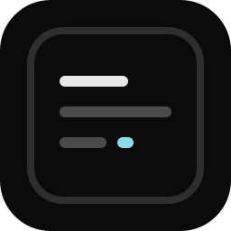

<p align="center">
  
</p>

<h1 align="center">gtui</h1>

<p align="center"><b>Terminal user interfaces for Go, written like HTML.</b></p>

<p align="center">
  A div is a box · classes are utilities · links swap a target div<br>
  block &amp; flex layout · diffed cell rendering · themes · i18n · 110+ components · 198 icons
</p>

```go
package main

import "github.com/orayew2002/gtui"

func main() {
	gtui.Init().HTML(
		gtui.Center("full bg-canvas",
			gtui.Column("rounded border-accent bg-panel px-3 py-1 gap-0",
				gtui.Text("text-accent bold", "hello from gtui"),
				gtui.Text("text-muted", "press q to quit"),
			),
		),
	).Render()
}
```

```sh
go get github.com/orayew2002/gtui
```

## Why

Most TUI code places every cell by hand. gtui gives you the browser model instead — nested
boxes, utility classes, flexbox, wrapping text, focus and keyboard routing — on top of a renderer
that writes only the cells that actually changed.

- **Simple.** `Div(class, children...)` is the whole idea. Ids live in the class string: `#main`.
- **Fast.** A 120×40 frame with 220 nodes builds, lays out, paints and flushes in about a
  millisecond. Painting it costs 17 µs and flushing a changed row 29 µs, both with **zero
  allocations**, so a moving UI does not touch the collector.
- **Complete.** Tables, charts, forms, dialogs, images, video, animation, themes and translations —
  113 components and 198 icons, every one of them styled by the same classes.

```

 ╭─────────────┤n├╮ ╭─────────────────────────────────────────────────────────────────────────────╮
 │ ▌ gtui gallery │ │  tables                                                          ◐ theme    │
 │ ────────────── │ │  data tables with zebra rows, actions and a pager                           │
 │  1 buttons     │ ╰─────────────────────────────────────────────────────────────────────────────╯
 │  2 inputs      │
 │  3 pickers     │ ╭──────────────────────────────────────────────────────────────────────────┤c├╮
 │  4 tables      │ │╭───────────────────────────────────────────────────────────────────────┤a├╮█│
 │  5 lists       │ ││ people                                                       (  + new  ) │█│
 │  6 feedback    │ ││ zebra rows, selectable rows, row actions and a pager                     │█│
 │  7 charts      │ ││──────────────────────────────────────────────────────────────────────────│█│
 │  8 media       │ ││ NAME                                ROLE      STATUS                     │█│
 │  9 motion      │ ││──────────────────────────────────────────────────────────────────────────│││
 │  0 layout      │ ││ Ada Lovelace                        analyst   ● ready     edit     del   │││
 │  i icons       │ ││ Alan Turing                         engineer  ● pending   edit     del   │││
 │  t themes      │ ││ Grace Hopper                        captain   ● ready     edit     del   │││
 │  l languages   │ ││ Edsger Dijkstra                     professor ● failed    edit     del   │││
 │  s style       │ ││──────────────────────────────────────────────────────────────────────────│││
 │  e extras      │ ││ page 1 of 1                                         ‹ prev      next ›   │││
 │  v views       │ │╰──────────────────────────────────────────────────────────────────────────╯││
 │ ────────────── │ │                                                                            ││
 │ ⌕ ctrl+p       │ │click a row, or edit and del on the right                                   ││
 ╰────────────────╯ ╰─────────────────────────────────────────────────────────────────────────────╯
```

Every box can own a jump key. `key-c` draws a `┤c├` tab in its top border, and pressing `c` moves
focus straight into it — a dense screen stays one keystroke deep.

## Three things to learn

**1. Boxes.** Every component takes its classes first, children after.

```go
gtui.Row("gap-1 p-1",
	gtui.Column("w-1/3 rounded border-line bg-panel px-2",
		gtui.Text("text-ink bold", "sidebar"),
	),
	gtui.Div("grow scroll #main"),
)
```

**2. Routing.** `Href` swaps the contents of a target div — that is a whole SPA.

```go
gtui.Href("px-1 current:bold key-1", "home", "#main", homePage())
```

**3. State.** Keep it in your own variables and re-render the part that changed.

```go
app.Open("#main", moviesPage())   // one box
app.Refresh()                     // the whole view, keeping values and focus
```

## Styling, like Bootstrap

Every component's look is a class away. The class you pass always wins over the component's own
defaults, because classes apply left to right.

```go
gtui.Button("bg-accent text-canvas pill px-3 shadow", "Save", onSave)
gtui.Button("border border-danger text-danger rounded-pill", "Delete", onDelete)
gtui.Icon("text-warning", "star")
gtui.IconButton("bg-success text-canvas rounded px-2", "check", "Approve", onApprove)
gtui.Text("uppercase dim truncate", "a very long caption that gets cut cleanly")
```

- **colour** `bg-accent` `text-canvas` `border-danger` `bg-[#1c1c1c]` `opacity-50`
- **see-through** `bg-transparent` and `bg-opacity-0` hand the cells back; `bg-black/40` and
  `bg-opacity-40` mix with whatever is painted underneath
- **radius** `rounded` `pill` `rounded-pill` `rounded-none` and the border styles below
- **border** `border` `thick` `double` `dashed` `soft` `tight` `border-t|r|b|l|x|y`
- **text** `bold` `dim` `italic` `underline` `strike` `uppercase` `lowercase` `capitalize`
  `normal-case` `truncate` `nowrap` `pre`
- **effects** `shadow` `shadow-none`
- **state** prefix anything with `hover:` `focus:` `active:` `current:`

## Components

| | |
| --- | --- |
| structure | `Div` `Row` `Column` `Center` `Centered` `Spacer` `Text` `Card` `Panel` `Window` `Grid` `Columns` `Split` `Divider` `Separator` `Toolbar` `Navbar` `Scrollbox` |
| icons | `Icon` `IconText` `IconButton` `IconNames` `IconGlyph` `RegisterIcon` — 198 named glyphs, each exactly one cell wide |
| navigation | `Href` `Tabs` `TabView` `Breadcrumb` `Pagination` `Dropdown` `MenuItem` `Tree` `TreeView` `Accordion` `Collapse` `Stepper` `Steps` `app.Palette` |
| data | `DataTable` (toolbar, zebra, selectable rows, `RowActions`, footer, pager) `Table` `TableHead` `TableRow` `Col` `Cells` `List` `ListItem` `ListRow` `KeyValue` `StatCard` `Metric` `Chips` `Tag` `Badge` `Pill` `Toggle` `Avatar` `Rating` `Timeline` `ScrollList` |
| forms | `Input` `Password` `Number` `Email` `URL` `Phone` `Date` `Search` `TextArea` `Checkbox` `Radios` `Select` `Selector` `Autocomplete` `Range` `Switch` `Calendar` `Button` `ButtonGroup` `Clickable` `Field` `InputGroup` |
| feedback | `Alert` `Banner` `EmptyState` `Spinner` `Loader` `Progress` `Gauge` `Skeleton` `StatusDot` `Hint` `Kbd` `StatusBar` `app.Modal` `app.Toast` |
| dialogs | `app.Confirm` `app.Alert` `app.Prompt` `app.Choose` `app.Busy` |
| charts | `BarChart` `Sparkline` `LineChart` `Donut` `Gauge` `Progress` |
| views | `CodeView` `Chat` `Logs` `AddressBar` `Toolbar` |
| media | `Image` `Fit` `ImageFrom` `FitFrom` `Backdrop` `BackdropFrom` `Viewer` `OpenClip` `OpenClipSized` + `Clip.Frame` `Player` `SeekBar` `Video` `VideoPlayer` |
| motion | `Marquee` `Typewriter` `Blink` `Pulse` `Wave` `Dots` `Equalizer` `app.Animate` `app.Every` `app.After` |

## Classes

- layout `row` `col` `center` `block` `inline` `none` `flex-wrap` `absolute` `z-5`
- size `w-20` `h-3` `full` `w-1/3` `w-50%` `min-w-10` `max-h-8` `grow` `shrink-0` `basis-10`
- spacing `p-1` `px-2` `py-1` `pt-1` `m-1` `mx-2` `gap-1` `gap-x-2` `gap-y-1`
- align `justify-center|between|around|evenly` · `items-*` · `self-*` · `text-left|center|right`
- border `border` `rounded` `pill` `rounded-pill` `rounded-none` `thick` `double` `dashed` `soft`
  `tight` `border-t|r|b|l|x|y` `border-accent`
- colour `bg-panel` `text-ink` `border-line` `text-danger` `bg-[#1c1c1c]` `opacity-50`
- see-through `bg-transparent` `bg-opacity-0` `bg-opacity-40` `bg-accent/40` `bg-[#000000]/55`
- text `bold` `dim` `italic` `underline` `strike` `uppercase` `lowercase` `capitalize` `normal-case`
  `truncate` `nowrap` `pre`
- effects `shadow` `shadow-none`
- overflow `clip` `scroll` `scroll-x` `visible` `focusable`
- state `hover:` `focus:` `active:` `current:`

## Keyboard

| key | action |
| --- | --- |
| `tab` `shift+tab` | move focus anywhere |
| arrows | move inside the current box; open a picker and walk its list; scroll a `scroll` or `scroll-x` box |
| `enter` `space` | activate a link, button, switch, row, menu item |
| `key-x` class | press `x` to jump into that box (`┤x├` badge in its border, `key-hide` hides it) |
| `pgup` `pgdn` `home` `end`, wheel | scroll vertically or sideways |
| `← →` `home` `end` in a field | move the caret; `delete` and `backspace` edit in place |
| paste | arrives as one `paste` event and lands at the caret |
| `esc` | close a modal, a dialog or an open picker |
| `app.Bind("ctrl+p", fn)` | your own shortcut |

Every control answers the keyboard alone: text fields edit in place and scroll their value to the
caret, `Select`, `Selector` and `Autocomplete` open and walk their lists with the arrows, `Range`
and `Calendar` move with the arrows, and a picker closes itself when focus leaves it.

A dialog takes the whole terminal while it is open: `tab` cannot leave it, a jump key cannot pull
the keyboard behind it, and a click beside it does not reach the page it covers. `esc` closes it.

`go run ./app audit` presses the mouse on every cell of every page, hovers everywhere, turns the
wheel, and walks the keyboard through every stop — checking after each event that focus still
points at something real and on screen, that no line overflows the terminal, and that whatever a
click opened `esc` can close.

## Forms and dialogs

```go
gtui.Column("gap-1",
	gtui.Field("", "Name", gtui.Input("w-full rounded border-line #name", "name", "full name")),
	gtui.Field("", "Plan", gtui.Select("w-full rounded border-line #plan", "plan", "choose",
		"free", "team", "business")),
	gtui.InputGroup("",
		gtui.Text("px-1 text-muted", "https://"),
		gtui.Input("grow rounded border-line #site", "site", "example.com"),
		gtui.Button("rounded border-accent text-accent", "check", onCheck),
	),
)

app.OnInput("#name", func(e *gtui.Event) { app.Text("#hint", e.Value) })
app.OnChange("#plan", func(e *gtui.Event) { app.Toast("info", e.Value) })

name := app.Value("#name")
app.SetValue("#plan", "team")
all := app.Values()
```

Dialogs are one call and need no state of your own:

```go
app.Confirm("Delete row?", "This cannot be undone.", func() { remove(at) })
app.Prompt("Rename", "name", "new name", func(v string) { rename(at, v) })
app.Choose("Pick a language", []string{"go", "rust", "zig"}, func(v string) { use(v) })
app.Alert("Saved", "All changes are on disk.")

done := app.Busy("uploading")   // spinning modal
defer done()
```

## Transparency

A background below full strength is mixed with whatever is painted underneath, so a picture can
carry readable text and a panel can sit over the page without hiding it.

```go
gtui.Div("bg-transparent", …)        // paints nothing: what is behind shows
gtui.Div("bg-opacity-0", …)          // the same thing, said the other way
gtui.Div("bg-accent/40", …)          // 40% accent over whatever is below
gtui.Div("bg-[#000000]/55", …)       // a scrim, which is what makes text on a picture readable
```

The app itself can step aside too, so the terminal's own colour scheme, its translucency or the
picture behind it stays visible:

```go
app := gtui.Init().Transparent(true)   // gtui paints no background of its own
```

`Transparent` leaves boxes that ask for a background alone, so the ones that should let the
terminal through say `bg-transparent`. It survives a theme switch, and `Transparent(false)` puts
the theme's canvas back.

## Pictures

Images decode to half-block cells — two pixels per character — so a 40×12 box shows 40×24 pixels
in truecolor.

```go
gtui.Image("rounded border-line", "poster.png", 40, 12)   // stretch to the box
gtui.Fit("rounded border-line", "poster.png", 40, 12)     // keep the aspect ratio
gtui.ImageFrom("", rendered, 40, 12)                       // from an image.Image

gtui.Backdrop("rounded", "cover.jpg", 40, 10,              // picture behind content
	gtui.Column("px-1",
		gtui.Text("bold text-canvas", "Night sky"),
		gtui.Text("text-canvas", "4k · 2.1 GB"),
	),
)

gtui.Viewer(gtui.ViewerOptions{Paths: shots, Index: at, Width: 40, Height: 12, Zoom: 2})
```

A width and height of zero means *fill the box*, the way a background picture does: the canvas adds
nothing to the layout, takes the room its classes give it, and is resampled whenever that changes.
One of these around the whole app is a wallpaper.

```go
gtui.Backdrop("h-6 rounded border-line", "cover.jpg", 0, 0,     // fills the box
	gtui.Text("bg-[#000000]/55 text-canvas bold", " night sky "),
)

gtui.Backdrop("full", "wall.png", 0, 0, shell())                 // behind everything
```

Animated GIFs load as clips, with frames flattened so each one is a whole picture:

```go
clip, err := gtui.OpenClip("preview.gif")

app.Every(clip.Delay(frame), func(tick int) {
	frame++
	app.Open("#screen", clip.Frame("", frame, 48, 14))
})
```

`Player` gives a music view — title, clock, seek bar, volume, queue — and `VideoPlayer` gives a
video one with play, seek and fullscreen callbacks.

## Themes

Tokens resolve while styles compute, so switching costs one frame and no rebuild.

```go
app.Theme(colors.Light)       // or colors.Dark
app.ToggleTheme()
app.ThemeByName("midnight")

app.Tokens(func(t *colors.Theme) {    // your own palette
	t.Name = "midnight"
	t.Canvas = colors.RGB(8, 10, 20)
	t.Accent = colors.RGB(120, 200, 255)
})
```

Tokens: `canvas` `panel` `raised` `line` `muted` `ink` `accent` `success` `warning` `danger` `info`.

## Languages

One flat or nested JSON file per language.

```go
gtui.LoadLanguages("locales")      // en.json, tk.json, ru.json
gtui.SetFallback("en")

app.View(shell)                    // register the builder once
app.Language("tk")                 // rebuilds, keeps values and focus

gtui.T("movies")                   // "filmler"
gtui.T("action.create", "film")    // "+ film goş"
```

Nothing is stored per node, so a switch is one map swap plus a single rebuild.

## Animation

```go
app.Animate(8, func(tick int) {        // 8 frames per second
	app.Open("#main", dashboard(tick))
})

app.After(2*time.Second, func() { app.Toast("success", "done") })
```

The diffing writer means a moving UI still sends only the cells that changed.

## Examples

```sh
go run ./app                   # the component gallery — one page per group
go run ./app check             # drive the gallery and report pass/fail per component
go run ./app audit             # poke every page with the mouse and the keyboard
go run ./examples/hello        # one centered card
go run ./examples/dashboard    # stat cards, charts, a compact table
go run ./examples/form         # inputs, selector, range, switch, toasts
go run ./examples/browser      # tab bar, address bar, page, status bar
go run ./examples/player       # media player with seek, volume, queue
go run ./examples/editor       # file tree, code view with gutter, status bar
go run ./examples/chat         # assistant thread with a prompt box
```

`app/` is a **gallery**: every page holds live, clickable examples of one component group, so you
can try each one by hand. Press the letter in a box's border to jump into it, then `enter`.

| page | what you can click |
| --- | --- |
| `1` buttons | button variants in pill, shadow and colour, button groups, icon buttons, `Clickable` rows, dropdown, tabs, dialogs, command palette |
| `2` inputs | text, number, password, email, url, phone, search, **text area**, checkbox, switch, `Field`, `InputGroup`, and a field watched with `app.OnInput` / `app.OnChange` |
| `3` pickers | selector, autocomplete, select, range, radios, **calendar**, the `Choose` dialog |
| `4` tables | data table with zebra rows, selection, row **edit/delete** actions, footer and pager, plus the same table built by hand from `TableHead` and `TableRow` |
| `5` lists | **tree view** and static tree, accordion, collapse, scroll list, list rows, key/value, chips, tags, timeline, steps |
| `6` feedback | four alert kinds, banner, empty state, toasts, a bare `app.Modal`, `Confirm` / `Prompt` / `Alert` / `Busy`, progress, gauge, spinner, loader, skeleton, status dots, badges, pills, toggle, rating, avatars |
| `7` charts | bar chart, sparkline, line chart, gauges, donuts, stat cards |
| `8` media | **picture viewer** with zoom, `Image` / `Fit` / `ImageFrom` side by side, picture as a **backdrop**, a gif read back with `OpenClip`, **video player**, **music player** with queue and equalizer |
| `9` motion | marquee, typewriter, blink, pulse, wave, dots, equalizer, spinner |
| `0` layout | rows, columns, wrapping grid, split, scroll in both directions, centering, `Card`, target-swapping `Tabs` |
| `i` icons | all 198 icons with a live filter and a pager, plus one glyph added with `RegisterIcon` |
| `t` themes | every token swatch, dark/light/custom switching, the live theme name, and the `UseCursor` / `UseMouse` switches |
| `l` i18n | three languages, the key table, `T` with arguments, fallback behaviour, and a language added at runtime with `AddLanguage` |
| `s` style | borders, radius, shadow, text transforms, truncation, every colour token, spacing, sizing, alignment, state variants |
| `e` extras | navbar, panel, window, banner, empty state, timeline, steps, metrics, separators, loaders, scrollbox, columns, kbd, tags |
| `v` views | chat thread, coloured logs, code view with a gutter, address bar, toolbar, breadcrumb, stepper, pagination, status bar |

The gallery is also the reference for laying out a real app:

```
app/main.go          wiring: theme, languages, routes, run
app/routes.go        the page table and the command palette
app/shell.go         sidebar, header, theme switch
app/demo.go          tiny helpers used by every page
app/page_*.go        one file per page
app/locales/*.json   the gallery's own translations
app/check.go         the self check behind `go run ./app check`
app/audit.go         the interaction audit behind `go run ./app audit`
```

Adding a page is one file plus one line in `routes.go`.

```sh
go run ./app snapshot 110 30               # print a frame as text
MODE=light PAGE=charts go run ./app snapshot 110 30
```

## API

```go
app := gtui.Init()

app.HTML(components...)         // mount a document
app.View(build)                 // mount a builder; Refresh / Language re-run it
app.Open(sel, components...)    // replace the children of one box
app.Add(sel, components...)
app.Query(sel) / app.QueryAll(sel)
app.Text(sel, text) / app.Class(sel, class, on)
app.Value(sel) / app.SetValue(sel, v) / app.Values()
app.OnClick(sel, fn) / app.OnChange(sel, fn) / app.OnInput(sel, fn) / app.OnKey(fn)
app.Modal(title, body...) / app.CloseModal() / app.Toast(kind, msg) / app.Palette(title, actions...)
app.Confirm(t, b, fn) / app.Alert(t, b) / app.Prompt(t, l, p, fn) / app.Choose(t, opts, fn) / app.Busy(l)
app.Focus(node) / app.Focused() / app.Select(sel) / app.Bind(key, fn) / app.QuitOn(keys...)
app.Theme(t) / app.ToggleTheme() / app.ThemeByName(n) / app.Tokens(edit) / app.Language(code)
app.Transparent(on)             // let the terminal's own background through
app.Animate(fps, fn) / app.Every(d, fn) / app.After(d, fn) / app.Do(fn)
app.Size() / app.OnResize(fn) / app.Copy(text)   // viewport, resize, clipboard
app.Press(key) / app.Type(text) / app.Flush()    // drive the keyboard from code
app.Click(x, y) / app.Hover(x, y) / app.Wheel(x, y, lines)   // and the pointer
app.UseMouse(on) / app.UseCursor(on)             // mouse capture and the real caret
app.Render()                    // open the terminal and run
app.Snapshot(w, h)              // render to plain text
```

## Requirements

Go 1.22+ and a terminal that speaks ANSI with truecolor. Mouse, resize and the alternate screen
are handled for you. `Image` decodes PNG/JPEG/GIF into half-block cells.

## License

MIT
